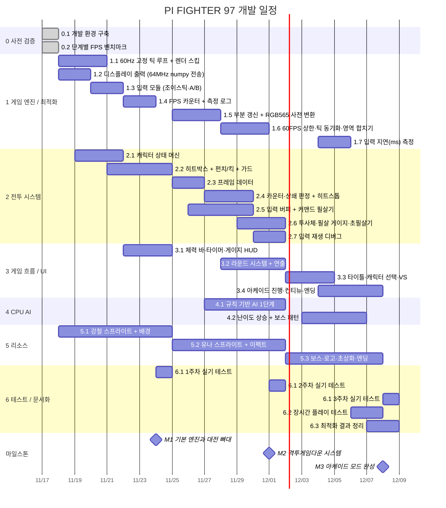

# ESW_PI_Fighter_97
2026 KAW ESW Term Project

**PI FIGHTER '97** 은 Raspberry Pi 5와 Adafruit 1.3" TFT Bonnet(240×240) 위에서 돌아가는 90년대 아케이드 감성의 1:1 대전 격투게임이다. 플레이어는 CPU 라이벌을 차례로 꺾고 최종 보스 **마감대마왕 데드라인** 에 도전한다.

## 핵심 목표

- **FPS 최적화** : SPI로 연결된 작은 TFT 화면에서 최적화를 하나씩 적용하고, 단계마다 FPS를 측정해 기록한다.
- **프레임 단위 판정** : 판정 로직을 60Hz 고정 틱으로 분리해, 화면 속도와 관계없이 상대 공격의 발생 구간을 끊는 카운터 판정이 정확하게 동작하도록 한다.

## 하드웨어 / 소프트웨어

| 구분 | 내용 |
|---|---|
| 보드 | Raspberry Pi 5 |
| 디스플레이 | Adafruit 1.3" Color TFT Bonnet (ST7789, 240×240, SPI) |
| 입력 | 5방향 조이스틱 + A/B 버튼 (본넷 내장) |
| 언어 | Python 3 (venv) |
| 라이브러리 | Pillow, numpy, adafruit-circuitpython-rgb-display, adafruit-blinka |

Pi 5에서는 venv 안의 `RPi.GPIO` 를 제거하고 Blinka + `lgpio` 조합으로 동작시킨다.

## 조작법

| 입력 | 동작 |
|---|---|
| 조이스틱 ← → | 이동 (상대 반대 방향을 누르고 있으면 가드) |
| 조이스틱 ↑ / ↓ | 점프 / 앉기 |
| A / B | 펀치 / 킥 |
| 커맨드 + A/B | 필살기 (예 : ↓↘→ + A) |
| 게이지 MAX + A+B | 초필살기 |

## 등장 캐릭터

| 캐릭터 | 타입 | 필살기 |
|---|---|---|
| 납땜왕 강철 | 파워형 | 솔더 웨이브 (↓↘→ + A), 오버클럭 어퍼 (→↓↘ + A) |
| 디버거 유나 | 스피드형 | 브레이크포인트 (↓↘→ + B), 스택 오버플로 (← 1초 모으기 → + B) |
| 마감대마왕 데드라인 | 보스 (CPU 전용) | 타임 아웃, F 학점 폭격 |

## 사전 실측 결과 (2026-11-17)

실제 하드웨어에서 대전 장면을 그리며 최적화 단계별 화면 FPS를 측정했다. 판정 로직은 모든 단계에서 60Hz를 유지했다.

| 단계 | 화면 FPS |
|---|---|
| 기준선 : Pillow + `disp.image()`, SPI 24MHz | 19.4 |
| SPI 64MHz | 39.9 |
| numpy로 RGB565 직접 전송 | 45.6 |
| 부분 갱신 (Dirty Rectangle) | **121.8** |
| 전송 스레드 분리 | 38.8 |

121.8FPS 단계에서는 티어링이 보여, 화면 갱신을 60FPS로 제한하고 판정 틱과 맞추는 방식을 적용한다. 측정 코드와 원본 데이터는 [`bench/`](bench/) 에 있다.

## 개발 일정

2026-11-18 ~ 2026-12-08 (3주). 진행 상황은 [Milestones](https://github.com/TomorrowIppo/ESW_PI_Fighter_97/milestones) 와 [Issues](https://github.com/TomorrowIppo/ESW_PI_Fighter_97/issues) 에서 관리한다.

| 마일스톤 | 기간 | 완료 기준 |
|---|---|---|
| M1 · 기본 엔진과 1:1 대전의 뼈대 | 11/18 ~ 11/24 | 두 캐릭터가 이동·공격·가드하며 체력이 줄어든다. 전체 화면 전송 40FPS 이상, 로직 60틱/초 유지 |
| M2 · 격투게임다운 시스템 | 11/25 ~ 12/1 | 커맨드 필살기·카운터·라운드, CPU 대전, 화면 60FPS 안정 유지 |
| M3 · 아케이드 모드 완성과 최종 점검 | 12/2 ~ 12/8 | 타이틀부터 엔딩까지 오류 없이 진행, 최소 45FPS / 평균 60FPS |



## 문서

- [프로젝트 제안서](docs/proposal.md)
- [FPS 벤치마크](bench/README.md)

## 엔진 검증

```bash
python3 -m unittest discover tests      # 하드웨어 없이 실행 가능
python3 tools/check_loop.py             # 고정 틱 루프 : 렌더 0~100ms에서 로직 60틱/초 유지 확인
```

`pifighter/engine/loop.py` 의 `FixedTickLoop` 은 판정 로직을 별도 스레드에서 60Hz 마감 시각에 맞춰 실행하고, 화면은 가장 최신 틱의 스냅샷만 그린다(렌더 스킵). Pi 5 실측(2026-11-23) : 실제 64MHz numpy 전체 화면 전송과 함께 돌렸을 때 화면 47.0FPS, 로직 60.00틱/초, 틱 지연 p99 0.12ms. 단일 스레드 누적 방식(`mode="accum"`)은 틱 수는 같지만 틱 지연 p99가 21.4ms로 한 틱보다 커서 기본값으로 쓰지 않는다. 가짜 렌더 측정 원본 : [`bench/results/loop_check_2026-11-23.csv`](bench/results/loop_check_2026-11-23.csv)
