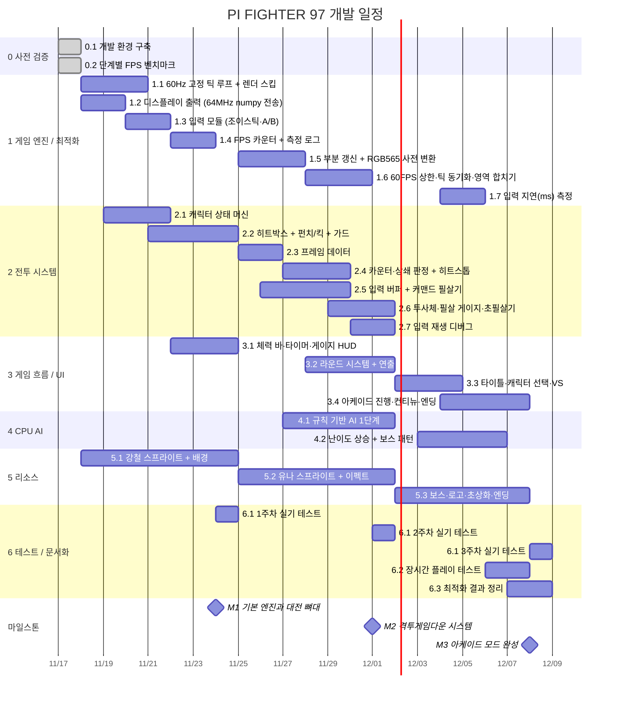

# 임베디드 SW입문 – 프로젝트 제안서 –

| 항목 | 내용 |
|---|---|
| 과목 | 임베디드 SW입문 |
| 지도교수 | 최차봉 교수님 |

---

## 1. 게임 이름 : PI FIGHTER '97 (파이 파이터 97)

라즈베리**파이(Pi)** 위에서 돌아가는 **파이터(Fighter)** 라는 뜻을 담은 이름이다. 뒤에 붙인 '97은 90년대 오락실 격투게임 특유의 "연도 붙은 시리즈 제목" 감성을 살리기 위한 장치로, 이름만 들어도 동전 넣고 즐기던 아케이드 격투게임이 떠오르도록 했다.

- 장르 : 1:1 대전 격투 (플레이어 vs CPU, 아케이드 모드)
- 그래픽 : 도트(픽셀아트) 스타일
- 등장 캐릭터와 기술은 모두 **직접 창작한 오리지널**이며, 기존 게임의 캐릭터·이름·그림은 사용하지 않는다. (90년대 격투게임의 "연출과 감성"만 오마주)
- **기술적 핵심 목표** : 격투게임은 1프레임 차이로 승패가 갈리는 장르라서, 다른 장르보다 **프레임률과 입력 반응 속도가 플레이 감각으로 바로 드러난다.** 이 프로젝트는 SPI 방식의 작은 TFT 화면이라는 제한된 하드웨어에서 **얼마나 최적화를 통해 FPS를 끌어올렸는지**를 단계별 측정값으로 보여주는 것을 핵심 목표로 한다. 특히 상대의 공격이 나오는 도중에 내 공격을 먼저 맞히는 **카운터 판정**처럼, 프레임 단위의 정확성이 필요한 시스템을 제대로 구현하는 것을 목표로 한다.

---

## 2. 게임 방법

### - 게임 프롤로그

1997년, 어느 공과대학의 임베디드 연구실. 기말 프로젝트 마감을 하루 앞둔 밤, 연구실 서버에 정체불명의 존재 **"마감대마왕 데드라인"** 이 깨어나 학생들의 코드를 전부 삼켜버리기 시작했다. 연구실 최강의 두 학생은 각자의 무기(인두와 키보드)를 들고 일어선다. 연구실의 라이벌들을 차례로 꺾고, 최후의 보스 데드라인을 쓰러뜨려야만 프로젝트를 무사히 제출할 수 있다.

### - 등장 캐릭터 (오리지널)

| 캐릭터 | 특징 | 필살기 (커맨드) |
|---|---|---|
| **납땜왕 강철** | 하드웨어 담당. 느리지만 한 방이 강한 파워형 | **솔더 웨이브** (↓↘→ + A) : 인두에서 납 덩어리를 날리는 장풍형 기술  /  **오버클럭 어퍼** (→↓↘ + A) : 무적 판정이 있는 대공 어퍼컷 |
| **디버거 유나** | 소프트웨어 담당. 빠르고 연타가 강한 스피드형 | **브레이크포인트** (↓↘→ + B) : 상대를 잠깐 멈추게 하는 빛 구슬  /  **스택 오버플로** (←(1초 모으기)→ + B) : 화면을 가로지르는 돌진기 |
| **마감대마왕 데드라인** (보스, CPU 전용) | 거대한 시계 모양의 보스. 체력·공격력이 높음 | **타임 아웃** : 화면 전체 공격 / **F 학점 폭격** : 위에서 떨어지는 투사체 |

※ 일정에 따라 플레이어블 캐릭터는 2명으로 확정하고, 여유가 생기면 1명을 추가한다.

### - 조작법 (Adafruit 1.3" TFT Bonnet)

| 입력 | 동작 |
|---|---|
| 조이스틱 ← → | 좌우 이동 (상대 반대 방향을 누르고 있으면 **가드**) |
| 조이스틱 ↑ | 점프 (↖ ↗ 대각 점프) |
| 조이스틱 ↓ | 앉기 (↙ 앉아서 가드) |
| A 버튼 | 펀치 |
| B 버튼 | 킥 |
| 조이스틱 커맨드 + A/B | 필살기 (예 : ↓↘→ + A) |
| 게이지 MAX 상태에서 A+B 동시 | 초필살기 (캐릭터별 1종) |

### - 카운터 시스템 (격투게임의 묘미)

모든 공격은 세 구간으로 나뉜다.

| 구간 | 설명 | 예 (강철의 펀치, 60틱 = 1초 기준) |
|---|---|---|
| **발생(Startup)** | 공격 동작이 시작됐지만 아직 판정이 나오지 않은 구간 | 1~5틱 |
| **지속(Active)** | 실제로 상대를 맞힐 수 있는 공격 판정 구간 | 6~8틱 |
| **후딜레이(Recovery)** | 공격이 끝나고 원래 자세로 돌아오는 무방비 구간 | 9~18틱 |

- 상대가 공격 버튼을 눌러 **발생 구간에 있는 동안 내 공격이 먼저 맞으면 "COUNTER!"** 문구가 뜨고, 데미지 1.25배, 경직 시간 증가, 필살 게이지 추가 충전 보너스를 받는다.
- 발생이 빠른 약공격으로 상대의 느린 강공격을 끊거나, 상대 공격의 후딜레이를 노려 반격하는 등 **"상대의 공격을 읽고 먼저 끊는" 심리전**이 생긴다.
- 두 공격이 **같은 틱에 동시에 맞으면 상쇄(서로 튕겨남)** 처리한다.
- 이 판정이 공정하려면 화면이 느려지는 순간에도 판정은 항상 같은 틱 간격으로 처리되어야 하며, 이를 위해 아래 3장의 "로직/렌더 분리" 구조를 사용한다.

### - 게임 진행 시나리오 (사용자 관점)

1. **타이틀 화면** : 전원을 켜면 "PI FIGHTER '97" 로고와 함께 **INSERT COIN** 문구가 깜빡인다. 아무 버튼이나 누르면 "코인이 투입"되고 **PRESS START** 로 바뀐다.
2. **캐릭터 선택** : 두 캐릭터의 얼굴 초상화가 나오고, 조이스틱으로 고른 뒤 A 버튼으로 결정한다. 제한시간 10초가 지나면 현재 커서의 캐릭터로 자동 선택된다.
3. **VS 화면** : 내 캐릭터와 첫 상대가 좌우에 크게 표시되는 "VS" 연출이 2초간 나온다.
4. **대전 시작** : 화면 중앙에 **ROUND 1** → **FIGHT!** 문구가 뜨며 라운드가 시작된다.
5. **대전 화면 구성**
   - 상단 : 양쪽 체력 바, 중앙에 **99초 타이머**
   - 하단 : **필살 게이지** (공격을 맞히거나 맞을 때 충전, 가득 차면 초필살기 사용 가능)
6. **라운드 판정** : 상대 체력을 0으로 만들면 화면이 잠시 멈추며 **K.O.** 가 뜬다. 99초가 지나면 남은 체력이 많은 쪽이 이기는 **TIME OVER** 판정. **3판 2선승제**로 먼저 두 라운드를 이기면 승리한다.
7. **승리 연출** : "YOU WIN!" 과 함께 다음 상대로 넘어간다. 아케이드 모드는 **라이벌 캐릭터 → 보스 데드라인** 순으로 2~3전을 치른다. 보스 등장 전에는 붉은 화면과 함께 **"WARNING! 마감이 다가온다"** 경고가 뜬다.
8. **패배 시 컨티뉴** : 지면 **CONTINUE? 9, 8, 7…** 카운트다운이 나오고, 0이 되기 전에 버튼을 누르면 그 상대와 다시 싸운다. 카운트가 끝나면 **GAME OVER** 후 타이틀로 돌아간다.
9. **엔딩** : 보스를 쓰러뜨리면 캐릭터별 짧은 엔딩 그림(프로젝트 제출 성공!)과 스태프 롤이 나온 뒤 타이틀로 돌아간다.

### - CPU 상대

CPU는 거리와 상황에 따라 행동을 고르는 간단한 AI로 움직인다. 멀면 장풍을 쏘거나 다가오고, 가까우면 공격하거나 가드하며, 플레이어가 점프하면 일정 확률로 대공기를 사용한다. 스테이지가 올라갈수록 반응 속도와 가드 확률이 높아져 난이도가 올라간다.

---

## 3. 구현에 필요한 기술

**사용 하드웨어/소프트웨어**
- Raspberry Pi 5, Adafruit 1.3" TFT Bonnet (ST7789, 240×240, SPI) – 5방향 조이스틱 + A/B 버튼
- Python 3 (가상환경 venv)
- 라이브러리 : `Pillow` (이미지 합성/그리기), `adafruit-circuitpython-rgb-display` (ST7789 드라이버), `adafruit-blinka`의 `board`·`digitalio` (버튼 입력, SPI), `numpy` (프레임 변환 가속)
- Pi 5는 GPIO 구조가 달라 venv 안의 `RPi.GPIO` 를 제거하고 `lgpio` 기반으로 동작시켜야 한다.

**디스플레이 출력** : 240×240의 작은 화면에서 캐릭터 두 명, 체력 바, 타이머, 게이지가 모두 잘 보이도록 화면 배치를 설계해야 한다. ST7789에는 게임기처럼 하드웨어 스프라이트 기능이 없으므로, Pillow로 메모리에 배경 → 캐릭터 → 이펙트 → UI 순서로 한 장의 프레임을 합성한 뒤 SPI로 전송한다. 스프라이트는 투명 배경 PNG(RGBA)를 시작할 때 한 번만 불러와 좌우 반전본까지 미리 만들어 둔다.

**로직/렌더 분리 (고정 틱 게임 루프)** : 판정 로직(입력 읽기, 이동, 히트박스, 카운터, 프레임 데이터)은 화면 속도와 상관없이 **항상 60Hz(1틱 = 약 16.7ms)** 로 실행한다. 화면은 남는 시간에 가장 최신 상태만 그려서 보내고, 전송이 밀리면 그 화면 프레임은 건너뛴다(렌더 스킵). 이렇게 하면 화면이 20FPS로 떨어지더라도 "발생 5틱짜리 공격은 언제나 5틱"이 보장되어 카운터 판정이 흔들리지 않는다. 판정 로직은 별도 스레드(또는 고정 시간 누적 방식)로 돌려, 화면 전송이 길어지는 순간에도 틱이 밀리지 않게 한다.

**프레임 데이터와 카운터 판정** : 모든 기술은 발생·지속·후딜레이 틱 수, 데미지, 경직 틱 수를 데이터로 가진다. 매 틱마다 양쪽 캐릭터의 공격 판정을 **동시에 검사한 뒤 한꺼번에 결과를 적용**하여, 먼저 처리된 쪽이 유리해지는 순서 문제를 없앤다. 피격자가 발생 구간이면 카운터, 같은 틱에 서로 맞으면 상쇄로 처리한다.

**화면 전송 최적화 (FPS 끌어올리기)** : 아래 순서로 하나씩 적용하며, 단계마다 화면 구석의 FPS 카운터와 로그로 측정값을 기록한다.
1. **기준선 측정** : Pillow 전체 화면 합성 + 기본 SPI 속도(24MHz)에서의 FPS와 한 프레임 처리 시간(합성/색 변환/전송 각각)을 측정한다.
2. **SPI 클럭 상향** : 24MHz → 40MHz → 64MHz 등으로 올려가며 화면이 깨지지 않는 한계를 찾는다.
3. **색 변환 최적화** : Pillow 이미지 → RGB565 변환을 numpy로 한 번에 처리하고, 배경·스프라이트는 미리 RGB565로 변환해 둔다.
4. **부분 갱신(Dirty Rectangle)** : 캐릭터·이펙트·UI가 바뀐 사각형 영역만 ST7789의 주소 창(window)을 설정해 전송하여, 매 프레임 보내는 데이터 양 자체를 줄인다. 영역 설정 명령도 오버헤드이므로 가까운 영역은 하나로 합친다.
5. **전송 스레드 분리** : 다음 프레임을 합성하는 동안 이전 프레임을 전송하는 더블 버퍼링 구조를 시험한다. (사전 실측에서는 오히려 느려져 채택하지 않을 가능성이 높다. 아래 결과 참고)
6. **입력 지연 측정** : 버튼을 누른 순간부터 화면에 반영되기까지의 시간(ms)을 측정해 최적화 효과를 확인한다.

### 사전 실측 결과 (구현 가능성 검증)

기획 단계에서 실제 하드웨어(Raspberry Pi 5 Model B + Adafruit 1.3" TFT Bonnet)로 벤치마크를 먼저 수행했다. 배경, 캐릭터 2명, 체력 바, 타이머가 있는 대전 장면을 매 프레임 그리면서 최적화 단계별로 일정 시간씩 측정했고, 동시에 60Hz 판정 로직 스레드를 돌려 틱이 일정하게 유지되는지 함께 기록했다. (측정일 2026-11-17, Python 3.13.5, numpy 2.2.4, Pillow 11.1.0) 같은 조건으로 2회 측정했으며(단계당 5초, 15초), 2회차도 기준선 19.2FPS, numpy 전송 45.6FPS, 부분 갱신 121.8FPS로 결과가 재현됨을 확인했다. 아래 표는 1회차 결과이다.

| 단계 | 방식 | 화면 FPS | 1프레임 전송 시간 | 판정 로직 | 틱 지연 p99 |
|---|---|---|---|---|---|
| 1 | 기준선 : Pillow + `disp.image()`, SPI 24MHz | **19.4** | 50.7ms | 60.0Hz | 1.06ms |
| 2 | SPI 클럭 40MHz | 29.1 | 33.6ms | 60.0Hz | 2.60ms |
| 2 | SPI 클럭 64MHz | 39.9 | 24.4ms | 60.2Hz | 2.48ms |
| 2 | SPI 클럭 80MHz | 39.9 | 24.4ms | 60.2Hz | 2.32ms |
| 3 | numpy로 RGB565 직접 변환·전송 (80MHz) | 45.6 | 21.2ms | 60.1Hz | 0.26ms |
| 4 | **부분 갱신(Dirty Rectangle)** (80MHz) | **121.8** | 7.6ms | 60.1Hz | 0.20ms |
| 5 | 전송 스레드 분리 (80MHz) | 38.8 | 25.8ms | 60.0Hz | 0.30ms |

**결과 분석**
- 아무 최적화 없는 기준선은 **19.4FPS**로, 격투게임으로는 부족한 수준이다. 장면 합성(Pillow) 자체는 프레임당 약 0.6ms로 매우 빠르고, 시간 대부분은 **SPI 전송과 데이터 변환**에 쓰인다.
- SPI 클럭을 올리면 FPS가 거의 비례해 오르지만, **64MHz와 80MHz의 결과가 완전히 같았다.** Pi 5의 SPI가 이 구간에서 같은 실제 클럭으로 맞춰지는 것으로 보여, 클럭만으로는 약 40FPS가 한계다.
- 기본 드라이버의 `image()`는 변환한 픽셀을 파이썬 리스트로 바꿨다가 다시 바이트로 만드는 과정이 있다. 이를 numpy로 직접 바이트 변환하도록 바꾸자 45.6FPS로 올랐다. 이론상 64MHz에서 화면 한 장 전송은 약 14ms인데 실측은 21ms로, 남은 차이는 Python과 드라이버 오버헤드다.
- 바뀐 영역만 보내는 **부분 갱신에서 121.8FPS**가 나와, 기준선 대비 **약 6.3배**가 되었다. 전송량 자체를 줄이는 것이 가장 효과적인 최적화임을 확인했다.
- 단, 실제 화면을 눈으로 확인한 결과 121.8FPS에서는 **티어링(화면 찢어짐)이 관찰**되었다. 패널은 약 60Hz로 화면을 다시 그리는데 그보다 두 배 빠르게 데이터를 써넣었기 때문이며, 60Hz를 넘는 프레임은 어차피 화면에 표시되지 않는다. 따라서 화면 갱신을 **60FPS로 제한해 판정 틱과 맞추고**, 바뀐 영역을 하나로 합쳐 한 번에 전송하는 방식을 채택한다(WBS 1.6).
- 전송 스레드 분리는 38.8FPS로 오히려 느려졌다. 합성이 0.6ms밖에 걸리지 않아 겹칠 작업이 거의 없고, 스레드 간 전환 비용만 추가되기 때문으로 보인다. 따라서 **단일 스레드 + 부분 갱신**을 기본 구조로 삼는다.
- 모든 단계에서 **판정 로직은 60Hz를 정확히 유지**했고, 틱 지연도 99%가 2.6ms 이하였다. 화면 속도와 상관없이 프레임 단위 판정(카운터 등)이 안정적으로 동작할 수 있음을 확인했다.

**결론** : 이 하드웨어에서 Python만으로도 60Hz 판정 + 60FPS 이상 화면 갱신이 가능하므로, 프레임 단위 판정이 필요한 격투게임의 구현 가능성을 확인했다. 단, 이 측정은 캐릭터 2명만 움직이는 장면 기준이므로, 이펙트와 투사체가 많아 바뀌는 영역이 넓어지면 FPS가 내려갈 수 있다. 이 경우를 대비해 갱신 영역 합치기와 이펙트 크기 제한을 함께 적용한다.

**스프라이트 애니메이션** : 캐릭터마다 대기, 걷기, 점프, 앉기, 펀치, 킥, 피격, 다운, 필살기 등의 동작을 여러 장의 도트 이미지(스프라이트 시트)로 만들고, 프레임 단위로 넘겨 애니메이션을 재생한다. 좌우 방향이 바뀌면 이미지를 반전해 사용한다.

**캐릭터 상태 머신** : 캐릭터는 한 순간에 하나의 상태(대기/이동/점프/공격/피격/가드/다운)만 가지며, 상태마다 할 수 있는 행동이 정해져 있다. 예를 들어 공격 중에는 이동할 수 없고, 피격 중에는 입력이 무시된다. 게임 전체도 타이틀 → 캐릭터 선택 → 대전 → 결과 → 컨티뉴 같은 화면 상태 머신으로 관리한다.

**히트박스 기반 충돌 판정** : 공격 동작의 지속 구간 틱에만 "공격 판정 박스"를 켜고, 상대의 "피격 판정 박스"와 겹치면 공격이 맞은 것으로 처리한다. 가드 중이면 데미지를 줄이고 뒤로 밀려나게 한다. 맞은 순간 몇 프레임 화면을 멈추는 히트스톱 연출로 타격감을 준다.

**커맨드 입력 인식 (입력 버퍼)** : ↓↘→ + A 같은 커맨드를 인식하기 위해 최근 약 0.5초(30틱) 동안의 조이스틱 방향 입력을 버퍼에 저장하고, 버튼이 눌린 순간 버퍼 안에 정해진 방향 순서가 있는지 검사한다. 조이스틱은 상하좌우 4개 스위치이므로 두 방향이 동시에 눌린 경우를 대각선으로 해석한다. 캐릭터가 오른쪽을 보는지 왼쪽을 보는지에 따라 커맨드 방향도 반전시킨다. 단, 모으기 기술(← 1초 모으기 → + B)은 입력 버퍼와 별도로 뒤쪽 방향을 누르고 있는 틱 수를 카운터로 세어, 60틱 이상 모은 뒤 앞 방향 + B가 들어오면 발동한다.

**버튼 입력 처리** : 버튼을 "누른 순간"과 "누르고 있는 상태"를 구분해야 한다. 공격은 누른 순간에만 한 번 나가고, 이동과 가드는 누르고 있는 동안 계속 적용된다. 물리 버튼의 떨림(채터링)은 프레임 단위로 입력을 읽어 자연스럽게 걸러낸다.

**CPU AI** : 거리, 상대 상태, 남은 체력을 보고 행동을 확률적으로 선택하는 규칙 기반 AI를 구현한다. 난이도는 반응 지연 프레임 수와 행동 확률을 조절해 단계별로 바꾼다.

**리소스 관리 및 코드 구조** : 캐릭터 데이터(체력, 이동 속도, 기술별 데미지·판정 프레임)는 JSON 등 별도 데이터 파일로 분리해 코드를 고치지 않고도 밸런스를 조정할 수 있게 한다. 코드는 `Game`, `Scene`(화면), `Fighter`(캐릭터), `InputBuffer`, `Projectile`, `CPUController`, `HUD` 클래스로 모듈화한다.

---

## 4. 예상되는 문제점과 해결책

**예상 문제점 1 : 화면 갱신 속도(FPS) 부족**
240×240×16비트 화면 한 장은 약 115KB(0.92Mbit)로, 이론상 SPI 24MHz에서는 전송만 약 38ms(약 26FPS), 64MHz에서는 약 14ms(약 69FPS)가 걸린다. 그러나 실제 사례를 보면 같은 1.3인치 240×240 ST7789 화면을 Python으로 구동했을 때 **약 3.5~5FPS밖에 나오지 않았다는 보고**가 있고, SPI 클럭을 80MHz에서 160MHz로 올려도 FPS가 거의 변하지 않았다고 한다. 즉 병목은 전송선보다 **Python 쪽의 이미지 변환과 함수 호출 오버헤드**에 있을 가능성이 크다. 실제로 우리 하드웨어(Pi 5 + TFT Bonnet)에서 사전 측정한 결과, 아무 최적화 없는 기준선은 **19.4FPS**였고 SPI 클럭은 64MHz 이상에서 더 빨라지지 않았다(3장 사전 실측 결과 참고). 최적화 없이 시작하면 격투게임으로서는 부족한 FPS가 나온다.
**해결 방안** : 3장의 "화면 전송 최적화" 단계를 순서대로 적용하며 측정한다. 색 변환을 numpy로 처리하고 리소스를 미리 RGB565로 변환해 Python 쪽 병목을 먼저 줄이고, 바뀐 영역만 보내는 부분 갱신으로 전송량 자체를 줄인다. 실제로 SPI 화면 최적화 사례에서는 프레임을 메모리에 먼저 그려 한 번에 보내는 것만으로 1375ms 걸리던 작업이 41ms로 줄었고, 바뀐 픽셀만 보내는 방식으로 12MHz의 느린 SPI에서도 팩맨을 60FPS로 구동했다. 또한 SPI 디스플레이를 60FPS급으로 구동하는 오픈소스 드라이버(fbcp-ili9341)가 사용하는 부분 갱신, 인터레이스 전송, 전송 전용 스레드 기법을 참고한다. (해당 드라이버 자체는 Pi 5를 지원하지 않으므로 기법만 Python으로 직접 구현한다.) Pi 5는 이전 모델보다 CPU가 훨씬 빨라 Python 쪽 병목 개선에 유리하다. 사전 측정에서 numpy 직접 전송으로 45.6FPS, 부분 갱신으로 121.8FPS까지 올라가는 것을 확인했으므로, 이 방향의 해결책이 실제로 효과가 있음을 검증했다.

**예상 문제점 1-2 : 화면 속도가 판정(카운터)에 영향을 주는 문제**
입력 → 판정 → 그리기 → 전송을 한 바퀴로 묶는 일반적인 루프에서는 전송이 느린 프레임마다 게임 자체가 느려진다. 그러면 "발생 5프레임" 같은 프레임 데이터가 실제 시간으로는 들쭉날쭉해지고, 상대 공격의 발생 도중을 끊는 카운터 판정이나 커맨드 입력 허용 시간도 함께 흔들린다.
**해결 방안** : 판정 로직을 60Hz 고정 틱으로 분리하고 화면은 렌더 스킵을 허용한다. 입력도 매 틱 읽으므로 화면이 느려져도 입력이 씹히지 않는다. 매 틱 양쪽 공격을 동시에 검사한 뒤 결과를 한꺼번에 적용해 처리 순서에 따른 불공정을 없앤다. 테스트를 위해 정해진 입력을 틱 단위로 재생하는 디버그 기능을 만들어, 같은 입력이면 화면 FPS와 관계없이 항상 같은 결과(카운터 여부)가 나오는지 검증한다.

참고로 이 본넷은 화면 갱신 타이밍 신호(TE 핀)가 연결되어 있지 않아, 패널 주사율(약 60Hz)보다 빠르게 화면을 쓰면 티어링(화면 찢어짐)이 생긴다. 실제로 사전 측정 중 부분 갱신으로 121.8FPS가 나온 단계에서 티어링이 관찰되었다. 이는 보기 문제일 뿐 판정에는 영향이 없으며, 화면 갱신을 60FPS로 제한해 판정 틱과 맞추고 바뀐 영역을 하나로 합쳐 한 번에 전송하는 방식으로 완화한다(WBS 1.6).

**예상 문제점 2 : 커맨드 입력이 잘 안 나가거나 엉뚱하게 나감**
작은 조이스틱으로 ↓↘→ 같은 입력을 정확히 하기 어렵고, 대각선 판정이 애매해 필살기가 안 나가거나 원하지 않을 때 나갈 수 있다.
**해결 방안** : 입력 버퍼의 허용 시간을 여유 있게 잡고, 중간에 다른 방향이 살짝 섞여도 순서만 맞으면 인정하는 너그러운 판정을 적용한다. 필살기 커맨드 종류를 캐릭터당 2개 정도로 제한하고, 실제로 여러 번 입력해 보며 허용 프레임을 조정한다.

**예상 문제점 3 : 히트박스와 밸런스 조정의 어려움**
판정 박스가 그림과 맞지 않으면 "분명 맞았는데 안 맞는" 상황이 생기고, 기술 데미지와 CPU 난이도가 맞지 않으면 너무 쉽거나 어려운 게임이 된다.
**해결 방안** : 디버그 모드에서 판정 박스를 색깔 사각형으로 화면에 표시해 그림과 맞춰본다. 데미지·판정 수치는 데이터 파일로 분리해 테스트하면서 바로바로 수정한다.

**예상 문제점 4 : 캐릭터 도트 리소스 제작 시간**
격투게임은 캐릭터마다 동작 수가 많아 그림 작업량이 크다.
**해결 방안** : 캐릭터 크기를 작게(약 32×48 픽셀) 잡고 동작당 2~4프레임으로 최소화한다. 공용 이펙트(타격 불꽃, 장풍)는 모든 캐릭터가 함께 쓰고, 상업적 이용이 허락된 무료 도트 리소스를 참고·활용한다. 처음에는 단색 사각형으로 로직을 먼저 완성하고 그림은 나중에 교체한다.

**예상 문제점 5 : Pi 5 환경 호환성**
Pi 5는 GPIO 칩 구조가 바뀌어 기존 예제 코드(RPi.GPIO 기반)가 그대로 동작하지 않을 수 있다.
**해결 방안** : venv에서 `RPi.GPIO`를 제거하고 Blinka + `lgpio` 조합을 사용한다. 1주차 초반에 버튼·디스플레이 테스트 코드를 먼저 돌려 개발 환경을 확정한다.

---

## 5. 주요 마일스톤 (WBS)

전체 작업을 산출물 기준으로 6개 영역으로 나누고(WBS), 각 작업을 3주 일정에 배치하였다. 0번(사전 검증)은 기획 단계에서 이미 완료한 작업이다.

### 5.1 개발 일정 (WBS 간트 차트)

2026-11-18(수)에 개발을 시작해 **2026-12-08(화)에 개발을 마무리**하는 3주 일정이다. 막대는 각 작업의 진행 기간, ◆는 주차별 마일스톤이다.

#### WBS 세부 내역 (산출물·완료 기준)

| WBS | 작업 | 산출물 / 완료 기준 | 주차 |
|---|---|---|---|
| **0** | **사전 검증** | | **완료** |
| 0.1 | Pi 5 + TFT Bonnet 개발 환경 구축 | venv에서 디스플레이·버튼 동작 확인 | 완료 |
| 0.2 | 단계별 FPS 벤치마크 | 기준선 19.4FPS → 부분 갱신 121.8FPS 실측 (3장 참고) | 완료 |
| **1** | **게임 엔진 / 최적화** | | |
| 1.1 | 60Hz 고정 틱 게임 루프 + 렌더 스킵 | 화면 FPS와 관계없이 로직 60틱/초 유지 | 1주차 |
| 1.2 | 디스플레이 출력 모듈 (SPI 64MHz, numpy 직접 전송) | 전체 화면 전송 40FPS 이상 | 1주차 |
| 1.3 | 입력 모듈 (조이스틱·A/B, 누름/유지 구분) | 매 틱 입력 반영, 씹힘 없음 | 1주차 |
| 1.4 | FPS 카운터 + 측정 로그 기능 | 단계별 FPS/전송 시간 CSV 기록 | 1주차 |
| 1.5 | 부분 갱신(Dirty Rectangle) + 리소스 RGB565 사전 변환 | 바뀐 영역만 전송 | 2주차 |
| 1.6 | 화면 60FPS 상한 + 판정 틱 동기화, 갱신 영역 합치기 | 티어링 완화, 60FPS 안정 유지 | 2주차 |
| 1.7 | 입력 지연(ms) 측정 | 버튼 → 화면 반영 시간 기록 | 3주차 |
| **2** | **전투 시스템** | | |
| 2.1 | 캐릭터 상태 머신 (이동·점프·앉기·가드·피격·다운) | 상태별 허용 행동 동작 | 1주차 |
| 2.2 | 히트박스 판정 + 펀치/킥 + 가드 | 피격 시 체력 감소, 가드 시 감소량 축소 | 1주차 |
| 2.3 | 프레임 데이터 (발생·지속·후딜레이) | 기술별 데이터 파일(JSON) | 2주차 |
| 2.4 | 카운터·상쇄 판정 + 히트스톱 | 발생 구간 피격 시 COUNTER!, 동시 히트 시 상쇄 | 2주차 |
| 2.5 | 입력 버퍼 + 커맨드 필살기 | ↓↘→ + A 10회 중 8회 이상 성공 | 2주차 |
| 2.6 | 투사체(장풍), 필살 게이지, 초필살기 | 게이지 충전 및 MAX 시 A+B 발동 | 2주차 |
| 2.7 | 입력 재생(리플레이) 디버그 기능 | 같은 입력이면 FPS와 관계없이 같은 결과 | 2주차 |
| **3** | **게임 흐름 / UI** | | |
| 3.1 | 체력 바, 99초 타이머, 게이지 HUD | 대전 화면 UI 완성 | 1주차 |
| 3.2 | 라운드 시스템 (3판 2선승) + ROUND 1 / FIGHT! / K.O. / TIME OVER 연출 | 승패 판정 정상 | 2주차 |
| 3.3 | INSERT COIN 타이틀, 캐릭터 선택, VS 화면 | 화면 전환 정상 | 3주차 |
| 3.4 | 아케이드 모드 진행, WARNING 연출, CONTINUE 카운트다운, GAME OVER, 엔딩 | 타이틀부터 엔딩까지 한 판 진행 | 3주차 |
| **4** | **CPU AI** | | |
| 4.1 | 규칙 기반 AI 1단계 (거리별 공격·가드·장풍) | 상황에 맞게 행동을 섞어 사용 | 2주차 |
| 4.2 | 스테이지별 난이도 상승 + 보스 데드라인 패턴 | 반응 지연·가드 확률 단계별 조정 | 3주차 |
| **5** | **리소스** | | |
| 5.1 | 납땜왕 강철 스프라이트 + 배경 1장 | 대기·걷기·펀치·킥·피격 | 1주차 |
| 5.2 | 디버거 유나 스프라이트 + 필살기·타격 이펙트 + 라운드 글자 | 2번째 캐릭터 플레이 가능 | 2주차 |
| 5.3 | 보스 스프라이트, 타이틀 로고, 초상화, 엔딩 그림 | 아케이드 모드 리소스 완성 | 3주차 |
| **6** | **테스트 / 문서화** | | |
| 6.1 | 주차별 실기 플레이 테스트 및 디버깅 | 주차별 테스트 목표 충족 | 매주 |
| 6.2 | 장시간 플레이 테스트 | 속도 저하·메모리 문제 없음 | 3주차 |
| 6.3 | 최적화 결과 정리 | 기준선 → 최종 FPS 변화 표/그래프 | 3주차 |

### 5.2 주차별 마일스톤

| 주차 (기간) | 마일스톤 | 포함 WBS | 완료 기준 (테스트 목표) |
|---|---|---|---|
| 1주차 (11/18~11/24) | **기본 엔진과 1:1 대전의 뼈대** | 1.1~1.4, 2.1~2.2, 3.1, 5.1 | 임시 그래픽으로 두 캐릭터가 이동·공격·가드하며 체력이 줄어든다. 전체 화면 전송 40FPS 이상, 로직 60틱/초 유지 |
| 2주차 (11/25~12/1) | **격투게임다운 시스템** | 1.5~1.6, 2.3~2.7, 3.2, 4.1, 5.2 | 커맨드 필살기·카운터·라운드가 동작하고 CPU와 대전할 수 있다. 화면 60FPS 안정 유지, 입력 재생으로 카운터 판정 재현성 확인 |
| 3주차 (12/2~12/8) | **아케이드 모드 완성과 최종 점검** | 1.7, 3.3~3.4, 4.2, 5.3, 6.2~6.3 | 전원을 켠 뒤 타이틀 → 캐릭터 선택 → 대전 → 보스전 → 엔딩까지 오류 없이 진행된다. 이펙트가 가장 많은 장면에서도 최소 45FPS, 평균 60FPS 유지 |

**주차별 공통 사항** : `git commit`으로 작업 진행 상황을 기록하고, 매주 실제 하드웨어(Pi 5 + TFT Bonnet)에서 직접 플레이하며 디버깅과 최적화를 진행한다. 최적화를 하나 적용할 때마다 같은 조건에서 FPS를 측정해 기록하고, 최종 발표에서 "기준선 → 최종" FPS 변화를 단계별로 제시한다.

---

## 참고 자료

- arcade_rpi2w : Adafruit ST7789 240×240 본넷 핀 설정을 지원하는 라즈베리파이 아케이드 게임 모음 (C++) – https://github.com/siliconvalleyar-oss/arcade_rpi2w
- Pimoroni 포럼, "Only 5 FPS with 1.3" SPI Colour LCD" : 240×240 ST7789 + Python FPS 실측 사례 – https://forums.pimoroni.com/t/only-5-fps-with-1-3-spi-colour-lcd/15379
- fbcp-ili9341 : SPI 디스플레이 고속 구동 드라이버 (부분 갱신, 인터레이스, DMA) – https://github.com/juj/fbcp-ili9341
- BitBank Software, "Optimizing access to serial (I2C/SPI) displays" – https://bitbanksoftware.blogspot.com/2019/08/optimizing-access-to-serial-i2cspi.html
- Adafruit 1.3" Color TFT Bonnet 가이드 – https://learn.adafruit.com/adafruit-1-3-color-tft-bonnet-for-raspberry-pi
